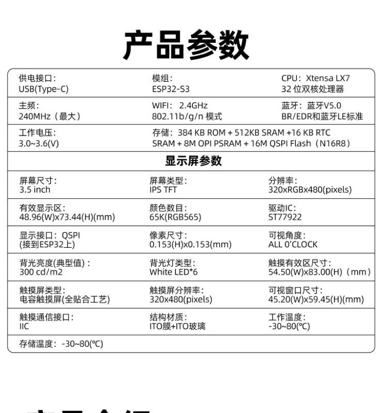

# lvgl_st77922_demo

ESP32-S3 (N16R8) + LCDWiki ES3C35P 3.5" 320x480 IPS（ST77922 QSPI + ST7123 触摸）桌面时钟 / 天气站。
ESP-IDF 5.4.1 + LVGL 9 + esp_lvgl_port。

## 硬件



| 部件 | 规格 |
|---|---|
| 模组 | ESP32-S3R8（8MB PSRAM + 16MB Flash，Wi-Fi 2.4G + BLE5） |
| 屏幕 | 3.5" IPS 320×480，ST77922，QSPI |
| 触摸 | ST7123 电容触摸，I²C（5 点） |
| 音频 | ES8311 codec + SC8002B 功放 + 1.25mm 喇叭座 |
| 供电 | USB-C 5V；TP4054 充电管理（4.2V 恒压）+ SL2305 电源切换 |
| 扩展 | microSD（4D SDIO）、I²C/UART/扩展 IO 座、WS2812 指示灯 |

引脚映射、充电电路、eFuse 摘要、横屏与触摸的实现陷阱见 **[docs/hardware.md](docs/hardware.md)**。

> 注：横屏是**软件旋转**实现的（本模块开启 MADCTL.MV 硬件旋转会花屏），
> 触摸噪声较大，固件里做了限幅滤波，详见上面的硬件文档。

## 功能

- 时钟页：48 号数字时钟、秒、星期日期、NTP 对时状态、音量滑块
- 天气页：重庆（写死 29.56N/106.55E）当前温度/天气/湿度/风速 + 3 天预报，Open-Meteo 免 key，30 分钟刷新
- 收音机页：24 个 MP3 网络电台（每页 8 个、头部 < > 翻页），播放/暂停、上一台/下一台、实时频谱与缓冲显示
- 顶部状态栏：电池电压 + 百分比（ADC1_CH7，1:2 分压）、Wi-Fi 信号、对时状态
- 左右滑动切换三页；BOOT 键切背光；RGB LED 指示 Wi-Fi 状态
- ES8311 音频（I2S），开机提示音 + 全局音量控制（时钟页/收音机页滑块同步）

引脚映射见 `main/main.c` 头部注释。

## 编译与烧写

本机已装好 ESP-IDF **5.4.1**（`~/esp/esp-idf`）与 esp32s3 工具链，直接用脚本：

```bash
./tools/build.sh        # 编译
./tools/flash.sh        # 烧写（自动找 /dev/cu.usbmodem*）
```

或手动：

```bash
. ~/esp/esp-idf/export.sh
cd lvgl_st77922_demo
idf.py build
idf.py -p /dev/cu.usbmodem14101 flash monitor
```

首次编译前先配置 Wi-Fi：

```bash
cp main/wifi_app_secret.h.example main/wifi_app_secret.h
# 然后填入你的 2.4GHz Wi-Fi 名称/密码（该文件不入库）
```

## 网络收音机

第三页是网络收音机：HTTP(S) 拉取 MP3 流 → libhelix 软件解码 → ES8311/I2S 出声。

- 24 个预置台在 `main/radio_stations.h`。只支持直接返回 `audio/mpeg` 的 **MP3 流**；
  HLS（`.m3u8`）和 AAC 不能播放。UI 每页 8 个、用标题栏的 `<` / `>` 翻页，
  列表长度不限（每页 8 个）。改表后重新编译；新台名/新分类出现新汉字时，
  跑一次 `tools/gen_radio_font.sh` 重新生成收音机字体。
- 播放/暂停、上一台/下一台、缓冲百分比、输出电平；音量和时钟页滑块双向同步。
- 频谱：播放任务对每帧解码出的 PCM 做 256 点 FFT（约 0.3 ms/帧，PSRAM 存表），
  映射成 16 个对数频段；UI 在 now-playing 卡片里自绘 16 根频谱条，
  换台/断流时自动回落。低码率流（如 22050 Hz）同样支持。
- 引擎分两个任务：`radio_net` 负责 HTTP/HTTPS 和 128 KB PSRAM 环形缓冲，
  `radio_play` 负责整帧解析/MP3 解码/I2S 写入。网络抖动不会直接卡住音频。
- 首次连接预缓冲 24 KB（64 kbps 约 3 秒），稳定后缓冲约 40%~50%。
- HTTPS 的 mbedTLS 工作缓冲放到 PSRAM（`CONFIG_MBEDTLS_EXTERNAL_MEM_ALLOC=y`），
  同时关闭未使用的蓝牙（`CONFIG_BT_ENABLED=n`）腾出内部 RAM；两者都已写进
  `sdkconfig.defaults`。
- 调试：`main/main.c` 顶部 `RADIO_SELFTEST` 置 1，会在连上 Wi-Fi 后自动依次
  播放/切台/暂停/恢复/停止，串口日志打印 `frames / underruns / buf / level`。

已知限制：

- 只支持 MP3 Layer III，不支持 HLS/AAC；电台源可能失效或有地区限制。
- 没有解析 ICY `StreamTitle`，界面显示电台名，不显示当前曲目。
- 换台要改 `radio_stations.h` 重新编译，暂未做网页配置/自定义 URL 输入。
- 采样率切换时可能打印两条 `i2s_channel_disable ... has not been enabled yet`，
  这是 `esp_codec_dev` 重配 I2S 的良性日志，不影响播放。

## 环境搭建踩坑记录（macOS x86_64 + 系统 Python 3.9）

国内网络下 GitHub 基本不可用，以下组合可以完整装好：

1. **ESP-IDF 源码**：`git clone https://gitee.com/EspressifSystems/esp-idf.git -b v5.4.1 --depth 1`。
   注意 gitee 镜像会把 `.gitmodules` 改写成 gitee 地址，而 gitee 上并没有这些子仓库，需要把子模块
   URL 改到 Espressif 的国内镜像组织 `https://jihulab.com/esp-mirror/<org>/<repo>.git`。
   子模块必须 checkout 到 v5.4.1 **钉住的 SHA**（`git ls-tree HEAD <path>` 取），不能用镜像分支 tip
   （二进制库版本漂移会导致构建异常）。
2. **工具链**：`export IDF_GITHUB_ASSETS=dl.espressif.cn/github_assets` 后执行 `./install.sh esp32s3`
   （默认会走 github.com 下载，慢到不可用）。
3. **Python 依赖**：`export PIP_INDEX_URL=https://pypi.tuna.tsinghua.edu.cn/simple`，
   并且 `pip install "cryptography<49"`（新版没有 cp39 wheel，源码构建需要 Rust）。
4. **Python 3.9 的 importlib.metadata 不做名称归一化**：`ruamel.yaml` 0.19+ / `ruamel.yaml.clib`
   的 dist-info 目录名是下划线形式，导致 IDF 的 `check-python-dependencies` 找不到包并刷出一堆
   假的 "requirements are not satisfied"。解决：装 `ruamel.yaml==0.18.6`，并给下划线目录补一个
   带点的别名，例如
   `ln -s ruamel_yaml_clib-0.2.15.dist-info ruamel.yaml.clib-0.2.15.dist-info`。
5. **cmake 必须是 3.x**：`pip install "cmake<4"`（cmake 4 与 IDF 5.4 的 CMake 脚本不兼容）。
6. 若 `setuptools` 装到 81+ 会移除 `pkg_resources`，IDF 需求检查器同样会崩，需 `setuptools<81`。

## 触屏滤波（重要）

这块屏的电容触摸噪声很大：实测**约 40 次/分钟的几百像素鬼点跳变**（ST7123 驱动不写任何阈值配置，
只读寄存器）。`main/main.c` 的 `tp_indev_read_cb()` 做了三层处理：

1. 5 个上报点里取接触面积（strength）最大的那个，避免鬼点抢先
2. **限幅平移**：位移超过 **3000 px/s × 实际间隔**（下限 30px、上限 240px）才视为鬼点，
   按上限沿原方向推进。不用"冻结/丢弃"，那会把滑动速度和惯性抹平，导致切页困难。
   限幅改成按时间计算，是因为 LVGL 任务偶尔会被收音机/TLS 延迟；固定 60px/poll
   在任务被延迟时会把正常快滑变成慢拖
3. 手指抬起立即上报 RELEASED，并在下次触摸时重置参考点

另外：

- 触摸轮询周期从默认 33ms 改为 **20ms（50Hz）**，拖动和点击更跟手
- **LVGL 任务优先级 6**，收音机播放 5、网络 4：TLS 握手或解码突发不会再把 UI/触摸饿住
- `TP_PROBE` / `TP_DEBUG_COORDS` 默认已置 0；排查触摸时再打开

运行时会限频打印 `touch ghost clipped (N total, max_step=...): x,y`，可用于长期观察噪声水平。

## 屏幕/触摸问题排查

固件现在会主动留下几类线索，先看串口（`tools/flash.sh` 后接 `idf.py monitor`，或用
`tools/serial_capture.py`）：

- **开机第一行** `reset reason: ...`：如果上次是 `brownout` / `power-glitch`，是供电问题；
  `panic` / `task-wdt` / `cpu-lockup` 是软件崩溃；`usb` / `power-on` 是正常刷机/上电。
- **每 10 秒** `UI alive: lvgl used ... / frag ... ; int heap ...`：LVGL 池 64KB，正常约用
  38%、碎片 2~4%；如果 `used` 接近 100% 或 `int heap` 很低，才是内存问题。
- **`UI STALL ... ms`**：LVGL 任务超过 5 秒没心跳。此时如果 `radio: frames=...` 还在打印，
  说明芯片没死，是 LVGL 任务被卡住（最可能是显示 flush 等 DMA 完成，或抢锁）；
  如果日志也完全停了，才是整机死机/重启。

常见原因和处理：

1. **供电**：屏幕背光 + 喇叭 + 充电同时工作可到 ~400mA，弱 USB 口/长线会让 5V 掉压，
   表现为屏幕花/卡/触摸乱跳，严重时 brownout 重启。换 5V/2A 充电头 + 短线，或拔掉电池
   只用 USB、降低音量测试。
2. **触摸不灵敏**：先确认没有厚保护膜、手指不太干；软件上可调
   `TP_MAX_SPEED_PX_S`（默认 3000）和 `TP_MIN_STEP`（默认 30）。如果日志里
   `touch ghost clipped` 很频繁，说明环境噪声大，不要盲目提高灵敏度。
3. **真死机**：把 `reset reason` 和最后 30 秒日志发出来。若看到 `UI STALL`，下一步是给
   `esp_lvgl_port` 的 `trans_sem` 加超时（当前是 `portMAX_DELAY`），避免 DMA 回调丢失后
   永久卡住。

## 横屏 480x320 的做法（含三个坑）

面板原生是 320x480 竖屏，横屏通过 **LVGL 软件旋转**实现，面板 MADCTL 保持原生竖屏：

```c
#define LCD_PANEL_H_RES 320        /* 面板原生 */
#define LCD_PANEL_V_RES 480
#define LCD_H_RES       480        /* 逻辑（旋转后） */
#define LCD_V_RES       320
#define LANDSCAPE_ROTATION  LV_DISPLAY_ROTATION_90

disp_cfg.hres = LCD_PANEL_H_RES;  disp_cfg.vres = LCD_PANEL_V_RES;
disp_cfg.flags.sw_rotate = true;
lv_display_set_rotation(disp, LANDSCAPE_ROTATION);
```

**坑 1：不能用 MADCTL.MV 硬件旋转。** 打开 `st77922_vendor_config_t.flags.supports_madctl_mv`
再调 `esp_lcd_panel_swap_xy()` 后，本模块画面会整体错乱（这正是 IDf 驱动把它做成"仅验证过的模组
才可开启"的原因）。只能用软件旋转。

**坑 2：`rounder_cb` 必须跟着转。** ST77922 要求 CASET（面板 X）4 像素对齐，而软件旋转 90° 之后
**面板 X 轴 = 逻辑 Y 轴**。如果还按竖屏去对齐 `area->x1/x2`，每个 16 行刷新块都会错位 →
表现为"元素花屏/错乱"。正确做法：

```c
#if (LANDSCAPE_ROTATION == LV_DISPLAY_ROTATION_90) || (LANDSCAPE_ROTATION == LV_DISPLAY_ROTATION_270)
    area->y1 = (area->y1 >> 2) << 2;
    area->y2 = ((area->y2 >> 2) << 2) + 3;
#endif
```

**坑 3：不要在触摸回调里自己转坐标。** LVGL 9 会对已注册 display 的 indev 自动做旋转换算
（`lv_indev.c` → `lv_display_rotate_point()`：`X = ver_res-1-y, Y = x`），它期望驱动上报
**面板原始坐标**（x:0..319, y:0..479）。如果驱动层再 swap/mirror 一次，就是"双重旋转"，症状是：
- 音量滑块只能拖到中间就拖不动（X 只覆盖 320/480）
- 竖直滑动反而切页（竖直轴被映射到了 LVGL 的 X）
- 屏幕只有一部分区域能点

所以 `TP_LAND_SWAP/MIRROR_*` 全部保持 0，让 LVGL 去转。

**校准方法（可复用）**：`TP_DEBUG_COORDS` 打开后，`boot_btn_task` 每秒心跳会把最近一次按下的
`raw=x,y`（面板原始）和 `mapped=x,y` 打出来，点四个角就能反推出映射关系。注意**不要**在其他任务里
主动调用 `esp_lcd_touch_read_data()` 做探针——那会把 LVGL 需要的触摸点提前消费掉。

## 已知问题 / 待办

- 中文字体是 `font_cn_14/16.c` 与 `font_radio_14/20.c` 的子集，**新增任何汉字都会显示空白**：
  收音机页改文案后用 `tools/gen_radio_font.sh` 重新生成，时钟/天气页仍按原来的
  `lv_font_conv` 命令生成
- 蓝牙已关闭（`CONFIG_BT_ENABLED=n`）以腾出内部 RAM；要用 BLE 时在 sdkconfig 重新打开
- 编译优化已从 Debug 改为 `-O2`（`CONFIG_COMPILER_OPTIMIZATION_PERF=y`），
  软件旋转 + MP3 解码需要这部分 CPU 余量
- 16MB flash 只用 3MB app 分区，其余空闲（未挂 SPIFFS/LittleFS）；收音机缓冲放在 PSRAM
- `TP_PROBE` / `TP_DEBUG_COORDS` 是触摸调试开关，稳定后可置 0 减少日志噪声
- HTTPS 电台依赖 NTP 时间同步；刚开机未对时完成时，证书校验可能失败

## 字体与许可

`main/font_cn_14.c` / `main/font_cn_16.c` 和 `main/font_radio_14.c` /
`main/font_radio_20.c` 都是用 `lv_font_conv` 从 **Noto Sans CJK SC / Noto Sans SC**
生成的子集（只含界面用到的汉字 + ASCII 0x20-0x7E），源字体采用
**SIL Open Font License 1.1**，许可全文见 `LICENSES/OFL-NotoSansCJK.txt`。

收音机页字体重新生成（需要 Node.js + lv_font_conv + fonttools）：

```bash
FONT=managed_components/lvgl__lvgl/tests/src/test_files/fonts/noto/NotoSansSC-Regular.ttf \
  ./tools/gen_radio_font.sh
```

时钟/天气页字体重新生成（需要 Node.js + lv_font_conv + Noto Sans CJK SC 的 OTF）：

```bash
npx lv_font_conv --font NotoSansCJKsc-Regular.otf --size 16 --bpp 4 \
  --format lvgl --no-compress --no-kerning --range 0x20-0x7e \
  --symbols 重庆晴间多云阴雾毛毛雨雪阵雷未知电量连接中失败关闭对时已同步音左右滑动查看天气湿风速更新加载周一二三四五六日度 \
  --lv-font-name font_cn_16 --lv-include lvgl.h -o main/font_cn_16.c
```

> 注意：新增任何汉字都必须重新生成字体，否则该字会显示为空白。

## 许可证

- 代码：[MIT](LICENSE)
- 字体子集（`main/font_cn_*.c`、`main/font_radio_*.c`）：由 **Noto Sans CJK SC /
  Noto Sans SC** 生成，[SIL Open Font License 1.1](LICENSES/OFL-NotoSansCJK.txt)
